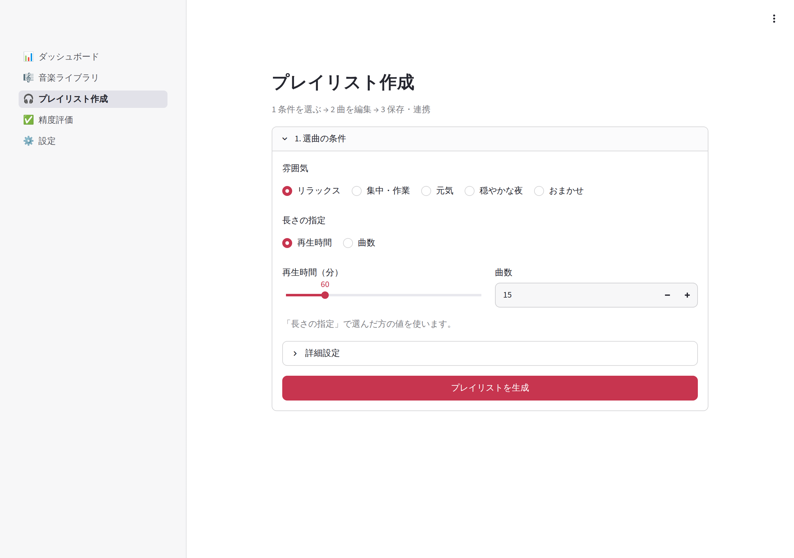

# volumio-playlist-studio

ローカルに保存した音楽を解析し、気分・ジャンル・テンポなどに応じたプレイリストを GUI から作成するアプリです。分類結果を人手で評価し、継続的に選曲品質を改善できるようにします。

Raspberry Pi 上の Volumio に保存した音楽を PC から SMB 共有経由で読み取り、PC 側で解析・選曲します。Volumio は音楽の保存と再生だけを担当し、Volumio 本体では解析を行いません。実行時に Claude は使わず、Python アプリと TypeSafe Jev API（任意）だけで動作します。



プレイリスト作成画面の上部です（サンプルデータの架空の楽曲）。この続きと、ほかの画面のキャプチャは [docs/SCREENSHOTS.md](docs/SCREENSHOTS.md) にまとめています。

## 実装状況

| 機能 | 状況 |
|---|---|
| 音楽フォルダのスキャン（初回・差分、mutagen によるタグ取得、文字化け修復、重複検出） | 実装済み |
| librosa による音響特徴量の抽出（区間サンプリング、無音区間の除外、処理時間の記録） | 実装済み（MP3/FLAC/OGG/WAV/AIFF。M4A/AAC はタグのみ） |
| SQLite への保存（マイグレーション、解析ロジックのバージョン記録、再解析の抑制） | 実装済み |
| ルールベース分類（タグ＋音響特徴量、Baseline） | 実装済み |
| TypeSafe Jev による分類（件数の見積もり、上限、エラー時の打ち切り） | 実装済み。**実 API での動作は未確認**（モックした HTTP 応答でのみテスト） |
| プレイリスト生成・編集・保存（seed による再現、条件不足時の説明） | 実装済み |
| 精度評価（人手評価、調整用／検証用の分割、指標、CSV 出力、プレイリストの満足度） | 実装済み |
| Volumio との連携 | 読み取り（プレイリスト一覧、曲の一覧の取得、ファイルとの照合）は実装済み。**プレイリストの登録はモッククライアントのみ**（[docs/volumio.md](docs/volumio.md)） |
| Essentia | 未導入（比較できる設計のみ。[docs/architecture.md](docs/architecture.md)） |
| Windows でのダブルクリック起動（`setup.cmd` / `start.cmd`） | 実装済み（Windows 上でセットアップ・起動・スキャン・解析まで確認） |
| スマホからの LAN 接続（PIN 認証） | 実装済み。**実機のスマホからの接続は未確認**（ロジックと画面はテストで確認） |

## 必要な環境

- Windows 10 / 11（PowerShell は Windows 標準のもので可）
- [uv](https://docs.astral.sh/uv/)（未導入なら `setup.cmd` の実行中に winget でインストールできます）
- Python 3.14（uv が `.python-version` に従って自動で用意します。手動でのインストールは不要です）

開発用には WSL2 / Linux でも動作します（[開発](#開発)）。

## セットアップ（Windows）

1. リポジトリを Windows のローカルディスクに取得します（例: `C:\Users\<名前>\volumio-playlist-studio`）

   ```powershell
   git clone <このリポジトリの URL> volumio-playlist-studio
   ```

2. エクスプローラーで **`setup.cmd` をダブルクリック** します。次を自動で行います
   1. uv の確認（ない場合は winget でのインストールを確認します。`Y` または Enter で続行）
   2. Python と依存パッケージを `uv.lock` どおりに用意（初回は数分かかります）
   3. `.env` がなければ `.env.example` からコピー

   実行内容は `data\logs\setup_YYYYMMDD_HHMMSS.log` に記録されます。

3. （Jev を使う場合）`.env` をメモ帳などで開き、API キーを設定します

   ```ini
   TYPESAFE_API_KEY=ts-xxxxxxxxxxxxxxxx
   ```

   API キーは <https://console.typesafe.ai/keys> で発行します。キーは `.env` にだけ保存し、画面にもログにも表示しません。未設定でも、ルールベースの分類で Jev 判定以外の機能をすべて使えます。設定を変えたらアプリを再起動してください。

## 起動

**`start.cmd` をダブルクリック** すると、アプリが起動して既定のブラウザで <http://localhost:8501> が開きます。

終了するときは、起動した黒いウィンドウで `Ctrl+C` を押すか、ウィンドウを閉じます（ブラウザのタブを閉じるだけではアプリは止まりません）。`Ctrl+C` の後に「バッチ ジョブを終了しますか (Y/N)?」と表示された場合は、`Y` と `N` のどちらを選んでもアプリは終了しています。終了後にブラウザに表示される「接続エラー」は、アプリが止まったことによるもので問題ありません。

- 初期設定ではこの PC からのみ接続できます
- 起動中にもう一度 `start.cmd` を実行すると、2 つ目は起動せず、起動中の画面をブラウザで開きます
- ポートを変えたい場合は `.env` の `VPS_PORT` を変更します

音楽ファイルがなくても、画面の「サンプルデータで試す」で架空の楽曲 60 曲を読み込み、選曲から保存までの流れを試せます。

### うまく動かないとき

- **ウィンドウがすぐ閉じる**: PowerShell で `.\setup.cmd` や `.\start.cmd` を実行すると、メッセージを確認できます
- **「仮想環境が見つかりません」**: 先に `setup.cmd` を実行してください
- **「ポート 8501 は別のプログラムが使用中」**: `.env` の `VPS_PORT` を別の番号（例: 8502）にしてください
- **起動に何分もかかる**: `\\wsl.localhost\...` などネットワーク上のフォルダから起動すると、ライブラリの読み込みが遅くなります。Windows のローカルディスクに置いてください
- **「スクリプトの実行が無効」**: ZIP でダウンロードした場合は、フォルダで `Get-ChildItem -Recurse | Unblock-File` を実行してから再実行してください

## 音楽フォルダの指定

画面の「音楽フォルダ」に、フォルダの絶対パスを入力します。

- **Volumio の SMB 共有**: Windows では UNC パスをそのまま指定できます（例: `\\volumio.local\Internal Storage`）。共有名はエクスプローラーのアドレス欄に `\\volumio.local` と入力して確認してください。共有の資格情報を求められる場合は、先にエクスプローラーで一度開いておきます
- **ローカルのフォルダ**: `C:\Users\<名前>\Music` など

アプリは音楽ファイルを読み取るだけで、タグの書き換えやファイルの移動・削除は行いません。SMB 共有越しの解析は、ローカルディスクより時間がかかります（初回の解析は 1 曲あたり数秒が目安）。

<details>
<summary>WSL で動かす場合</summary>

WSL から UNC パスは直接開けないため、読み取り専用でマウントしてから、マウント先を指定します（この手順は Volumio 実機では未確認です）。

```bash
sudo mkdir -p /mnt/volumio
sudo mount -t drvfs '\\volumio.local\Internal Storage' /mnt/volumio -o ro
```

`C:\Users\<名前>\Music` のような Windows のパスは、自動で `/mnt/c/Users/<名前>/Music` に変換します。

</details>

## 操作手順

1. **音楽ライブラリ**: 「スキャン」で楽曲を登録し、「未解析の曲を解析」で音響特徴量を求めます。2 回目以降は追加・更新されたファイルだけを処理します。解析中も画面は操作でき、進捗が表示されます。解析に失敗した曲は、ファイルが更新されるまで再試行しません（「失敗した曲を再試行」で改めて解析できます）
2. （任意）**音楽ライブラリ → Jev で判定する**: 対象曲数とリクエスト数を確認してから実行します。1 回の上限（既定 20 曲）は設定画面で変更できます
3. **プレイリスト作成**: 「1. 選曲の条件」で雰囲気と再生時間または曲数を選び、生成します。雰囲気は 10 種類と「おまかせ」から選べます（朝・爽やか、しっとり・切ないは曲調の明るさを使うため、Jev で判定した曲が必要です）。ジャンル・意外性・ランダム性・seed は「詳細設定」にあります。生成後は「2. 曲を編集」で一覧を確認し、対象の曲を選んで「上へ」「下へ」「除外」を操作します。「曲を追加する」から追加でき、「3. 保存・連携」で名前を付けて保存します。保存したプレイリストは、画面下部の「保存済みのプレイリスト」から削除できます（満足度などの評価は集計に残り、Volumio に登録したプレイリストは削除しません）。条件に合う曲が足りない場合は、理由と緩和案が表示され、「条件を緩和して再生成」を選べます。作成方法を「マップの円で選ぶ」にすると、明るさ × エネルギー感のマップ上で、雰囲気を中心とする円の中の曲を選べます。円の大きさを変えると、選ばれる曲数と合計時間がその場で変わります。上限（再生時間か曲数）を付けると中心に近い順に選びます（マップに載るのは Jev で判定した曲だけです）
4. **精度評価**: 30〜50 曲を評価対象に追加し、判定結果の正誤やジャンル・ムードの修正、属性の 5 段階評価を入力します。「集計・CSV」タブでルールベースと Jev の一致率などを比較し、CSV で保存できます。保存したプレイリストの満足度と不適切な曲も記録できます
5. **設定**: 「一般」で音楽フォルダ・Volumio 接続先・選曲に使う分類結果、「解析・AI」で解析パラメータと Jev の判定基準、「ログ」でログを確認・変更します。各設定フォームの「保存」で反映します。Volumio の接続先（例: `volumio.local`）を保存すると「接続テスト」で既存のプレイリスト一覧を確認できます
6. （任意）**プレイリスト作成 → 3. 保存・連携 → Volumio に登録**: 照合先に「Volumio 実機」を選び、「Volumio から曲の一覧を取得」すると、保存したプレイリストの曲が Volumio 上の曲と対応するかを確認できます。プレイリスト名を確認し、確認のチェックを入れて「Volumio に登録」を押すと、Volumio に新しいプレイリストを作成して曲を追加します（同じ名前のプレイリストがある場合は登録しません）。照合先に「モック（模擬）」を選ぶと、Volumio を変更せずに登録の流れを試せます

プレイリストの条件・編集中の名前・曲一覧は、同じブラウザセッション内の画面移動でも保持します。条件の変更だけでは曲一覧を置き換えず、「プレイリストを生成」を押したときに反映します。ブラウザの再読み込みやアプリの再起動をまたいで残すには保存してください。

音楽ライブラリの「絞り込み・表示項目」では、検索に加えて解析状況・判定ジャンルを指定できます。音響特徴量や判定の詳細は楽曲の詳細欄で開けます。

評価の進め方は [docs/evaluation.md](docs/evaluation.md) を参照してください。

## Jev（TypeSafe）の利用について

- 送信するのは、正規化したタグ情報（曲名・アーティスト・アルバム・ジャンルタグ・年）と、音響特徴量を言葉の区分（「slow (70-95 BPM)」など）に変換したものだけです。音声ファイルやファイルパスは送りません。曲名を送らない設定もできます
- 1 曲につき 1 リクエストです。料金は TypeSafe の料金体系に従います。実行前に画面で件数を確認してください
- 認証エラー・レート制限では即座に、通信エラーが連続した場合も中断し、無駄なリクエストを抑えます
- Jev の confidence は分類の正解率ではありません。精度は精度評価画面で確認してください

詳細は [docs/jev.md](docs/jev.md) を参照してください。

## サンプルデータ

```bash
# 架空の楽曲を DB に登録する（GUI の「サンプルデータで試す」と同じ）
uv run python -m volumio_playlist_studio.sample_data demo data/studio.sqlite3

# 合成音声（正弦波・クリック音）の FLAC を空のフォルダに作る。スキャンと解析を試せる
uv run python -m volumio_playlist_studio.sample_data audio /tmp/sample-music
```

## スマホから開く（自宅 LAN、任意）

iPhone の Safari などから、自宅 Wi-Fi 経由で画面を開けます。Windows で直接起動したときだけ使えます（WSL 内で起動するとスマホから届きません）。

1. Windows の「設定」→「ネットワークとインターネット」→「Wi-Fi」→ 自宅の Wi-Fi のプロパティで、ネットワーク プロファイルを **プライベート ネットワーク** にします
2. `.env` に `VPS_LAN=1` を設定します
3. `start.cmd` で起動します。初回は Windows ファイアウォールの許可を求められるので、**「プライベート ネットワーク」だけにチェックし、「パブリック ネットワーク」は外して** 許可します
4. PC のブラウザに「スマホで開く」画面（QR コードと 4 桁の PIN）が開くので、スマホのカメラで QR コードを読み取り、PIN を入力します

- `VPS_LAN=0`（既定）では `127.0.0.1` だけで待ち受け、PC 自身からしか開けません。`1` のときだけ全てのネットワークで待ち受けます
- PIN は起動ごとにランダムに作り直し、ファイルやログには保存しません。PC 自身（localhost）からのアクセスには PIN は不要で、「スマホで開く」画面は PC 自身からしか表示されません
- PIN を 5 回続けて間違えると PIN を作り直し、しばらく（30 秒。続けて間違えるたびに倍、最長 2 時間）入力を受け付けません。「スマホで開く」画面は 15 秒ごとに更新され、新しい PIN を表示します
- 正しい PIN を入力した端末は、そのブラウザのタブを開いている間は再入力不要です。ページの再読み込みやアプリの再起動の後は、もう一度 PIN を入力してください
- 同じ Wi-Fi の端末からは PIN 入力画面までは開けます。来客にはゲスト用の Wi-Fi を使ってもらってください
- 通信は HTTP のままです（暗号化は WPA2 / WPA3 の自宅 Wi-Fi に任せます）。ルーターのポート転送などでインターネットに公開しないでください
- PIN で保護するのは画面の表示と操作です。Streamlit が内部で提供するヘルスチェックなどのエンドポイントは PIN なしで応答します（ライブラリの内容は含みません）
- QR コードの IP アドレスが違う（VPN 接続中など）ときは、`ipconfig` で Wi-Fi の IPv4 アドレスを確かめ、`.env` の `VPS_LAN_ADDRESS` に設定して再起動してください

## データの保存場所

解析結果・評価・プレイリストはプロジェクト直下の `data\studio.sqlite3`、ログは `data\logs\app.log` に保存します（`.env` の `VPS_DATA_DIR` で変更可能）。どちらも Git 管理対象外です。スキーマを更新するときは、既存の DB を `studio.sqlite3.bak-v<バージョン>` にバックアップしてから移行します。

## 開発

開発は WSL / Linux で行う想定です。開発規約は [AGENTS.md](AGENTS.md) と [CLAUDE.md](CLAUDE.md) を参照してください。

```bash
uv sync
uv run python -m volumio_playlist_studio.launcher   # 起動（ブラウザを開かない場合は --no-browser）
```

| 用途 | コマンド |
|---|---|
| フォーマット | `uv run ruff format .` |
| 空行の挿入（インデントが戻る箇所） | `uv run python tools/insert_block_blank_lines.py src tests tools` |
| リント | `uv run ruff check .` |
| 型検査 | `uv run mypy` |
| テスト（カバレッジ 90% 未満で失敗） | `uv run pytest` |
| 画面キャプチャの撮り直し（[docs/SCREENSHOTS.md](docs/SCREENSHOTS.md#撮り直し方)） | `uv run python tools/capture_screenshots.py` |

テストは外部サービスと通信しません（Jev は HTTP 層をモック、Volumio は模擬サーバーとモッククライアント）。テスト用の音声はテスト内で生成します。Volumio 実機での確認（読み取りのみ）は、明示的に実行します。

```bash
VPS_TEST_VOLUMIO_HOST=volumio.local uv run pytest -m integration tests/test_volumio_live.py --no-cov
```

## ドキュメント

- [docs/SCREENSHOTS.md](docs/SCREENSHOTS.md): 各画面のキャプチャと撮り直し方
- [docs/architecture.md](docs/architecture.md): アーキテクチャ、データフロー、データモデル、実装タスク
- [docs/audio-features.md](docs/audio-features.md): 音響特徴量の意味と分類への使い方
- [docs/jev.md](docs/jev.md): Jev による分類の設計
- [docs/evaluation.md](docs/evaluation.md): 精度評価の手順と指標
- [docs/volumio.md](docs/volumio.md): Volumio 連携の調査結果と未確認事項
