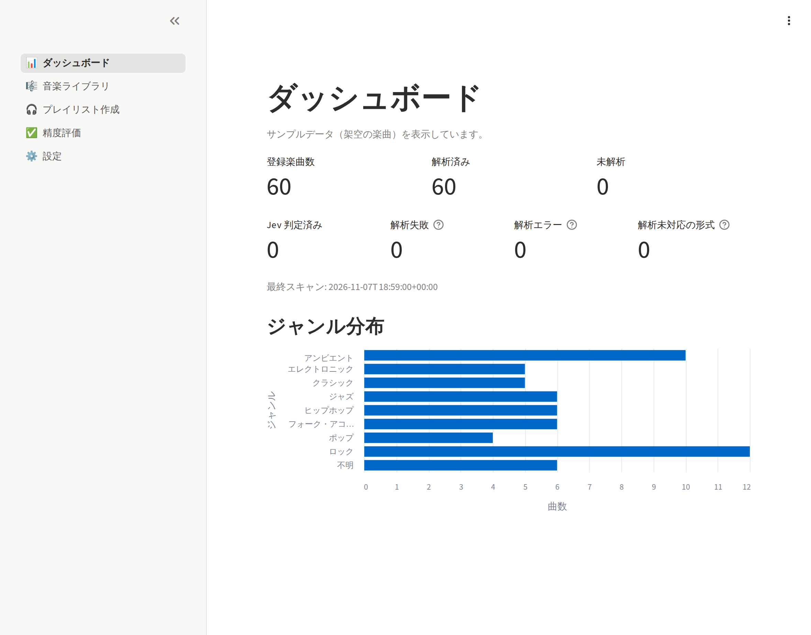
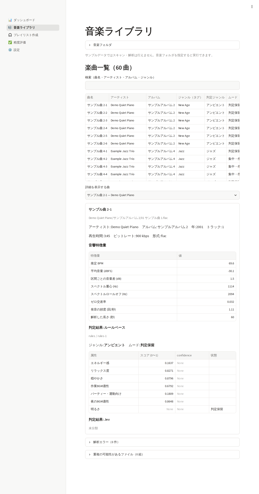
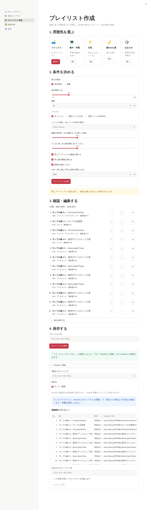
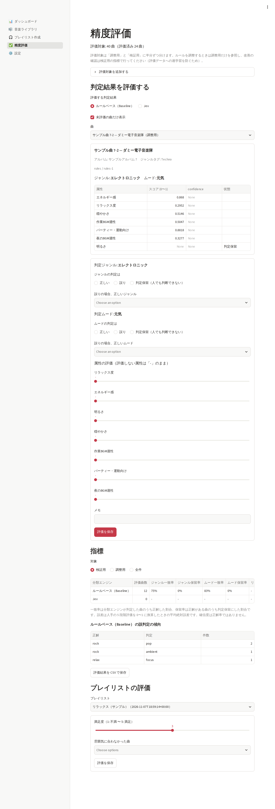
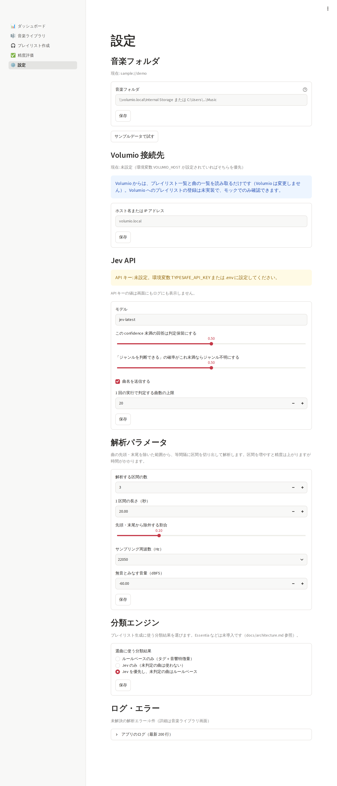
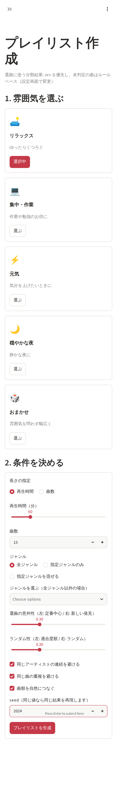

# 画面キャプチャ

volumio-playlist-studio の各画面です。キャプチャはすべて **サンプルデータ（架空の楽曲 60 曲）** で撮ったもので、実在の楽曲や利用者の音楽ライブラリは含みません。
操作の流れは [README](../README.md#操作手順) を参照してください。

キャプチャは `tools/capture_screenshots.py` で撮り直せます（[撮り直し方](#撮り直し方)）。

## ダッシュボード

登録楽曲数、解析済み・未解析・解析失敗などの件数と、ジャンル分布。



## 音楽ライブラリ

スキャン・解析・Jev 判定の実行と、楽曲の一覧・検索。選んだ曲の音響特徴量と、ルールベース・Jev それぞれの判定結果（ジャンル、ムード、属性スコア）を表示します。
サンプルデータではスキャン・解析は行えないため、ボタンは表示されていません。



## プレイリスト作成

雰囲気をカードで選び、再生時間（または曲数）・ジャンル・意外性・ランダム性などを指定して生成します。
生成後は曲の並び替え・除外・追加、名前を付けての保存ができ、保存したプレイリストを Volumio に登録する前のプレビュー（曲と Volumio 上のファイルの照合）を確認できます。
下のキャプチャは seed を固定して生成・保存した後の状態で、Volumio はモッククライアント（Volumio のライブラリを模擬）を使っています。



## 精度評価

評価対象の曲（調整用・検証用に半分ずつ）について、判定結果の正誤、正しいジャンル・ムード、属性の 5 段階評価を入力します。
入力した評価から分類エンジンごとの一致率・保留率と誤判定の傾向を表示し、CSV で保存できます。保存したプレイリストの満足度と、雰囲気に合わなかった曲も記録できます。
キャプチャの評価データは、撮影用に機械的に入力したものです（指標の値に意味はありません）。



## 設定

音楽フォルダ、Volumio の接続先、Jev の判定基準、解析パラメータ、選曲に使う分類結果、ログを確認・変更します。



## スマートフォン幅

カードや入力欄が縦に並びます（プレイリスト作成画面）。



## 撮り直し方

画面を変更したら、次のコマンドで撮り直します。一時フォルダにサンプルデータの DB を作ってアプリを起動し、Playwright で各画面を `docs/images/` に保存します。
`data/` の DB や `.env` の接続先・API キーは使わず、Volumio や Jev とは通信しません。

```bash
uv run playwright install chromium   # 初回のみ（ブラウザのダウンロード）
uv run python tools/capture_screenshots.py
```

日本語を表示するため、WSL / Linux では日本語フォントが必要です（例: `sudo apt install fonts-noto-cjk`）。
