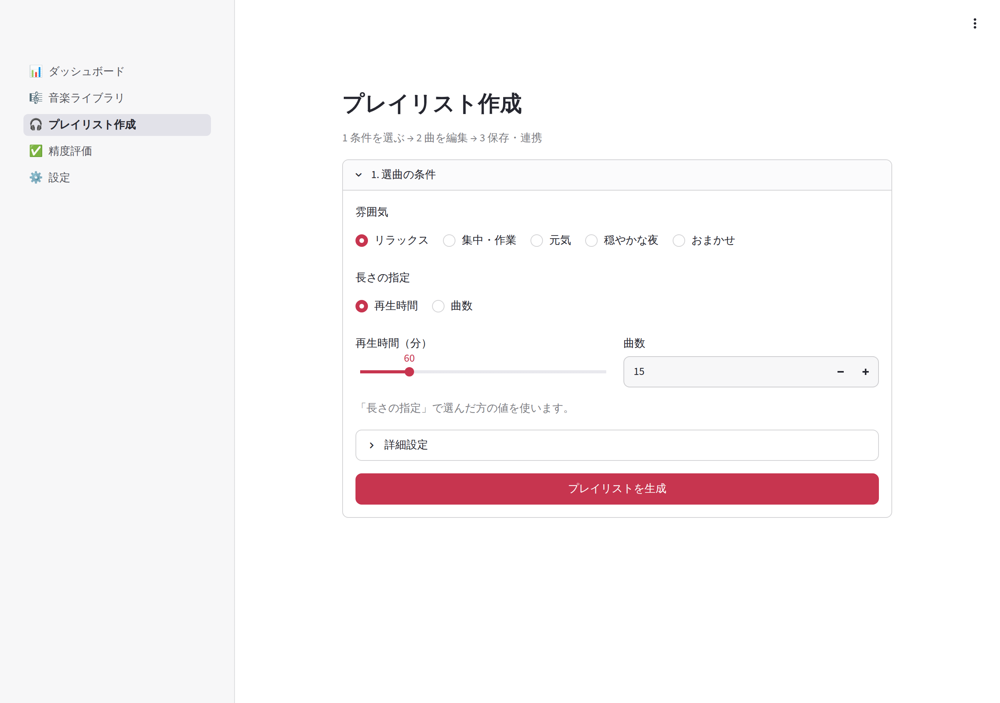
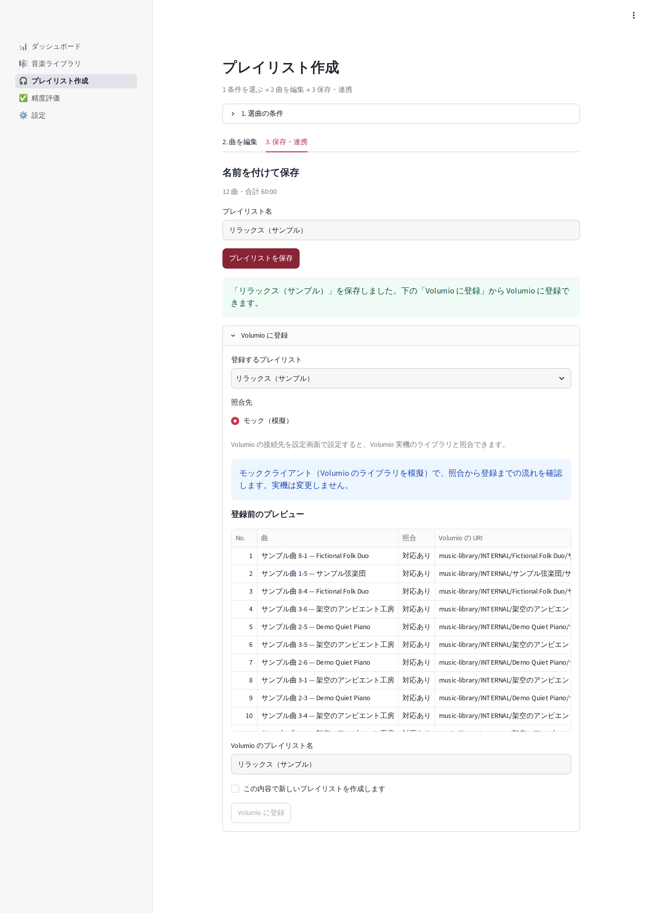

# 画面キャプチャ

すべて **架空の楽曲60曲** を使った画面です。利用者の音楽ライブラリや接続情報は含みません。
操作手順は [README](../README.md#操作手順)、状態管理は [architecture.md](architecture.md#gui-の表示と状態管理) を参照してください。

## UI/UX 改善の比較

既存画像と画面実装を照合し、次の順で改善しました。明るい背景・赤系アクセント、バックグラウンド処理の進捗、確認付きの外部通信、保存処理は維持しています。

| 優先度 | 改善前の課題 | 対応 |
|---|---|---|
| P0 | 雰囲気カード5枚がスマートフォンで縦に並び、生成ボタンが遠い | 折り返す選択欄に変更。主要条件と生成ボタンを最初の画面内に配置 |
| P0 | 条件・曲編集・保存・照合が1つの長いページ | 生成後は条件を折りたたみ、「曲を編集」「保存・連携」のタブを表示 |
| P0 | 曲ごとの3つのボタンが狭い画面で縦に積み上がる | スクロール可能な一覧と、選択した曲の「上へ」「下へ」「除外」に集約 |
| P0 | タイトルが「プレイリスト作／成」と分断される | テーマで見出しサイズを統一。390pxでも1行で表示 |
| P0 | ページ移動で入力部品の値が消える | 入力値をセッション内に退避。生成前の条件・編集中の名前・曲一覧を保持 |
| P1 | 技術指標が主要な件数と同じ優先順位 | 登録・解析済み・未解析を優先し、作成とライブラリへのボタンを追加。その他の指標は折りたたみ |
| P1 | ジャンル分布の長いラベルが省略される | 軸のラベル領域を確保。スマートフォンでもジャンル名を表示 |
| P1 | 一覧が多列で、特徴量が常時表示される | 基本列を優先。解析状況・判定ジャンルで絞り込み、追加列と音響特徴量は必要時に表示 |
| P2 | 評価入力と集計、一般設定と解析設定が混在 | 評価は「評価入力／集計・CSV／プレイリスト」、設定は「一般／解析・AI／ログ」に分離 |
| P2 | 属性スコア・確信度に `None` が表示される | 「判定保留」「対象外」と明示し、確信度の説明を添える |

旧スマートフォン画像は幅390px・全高2614px相当でした。現在は主要条件と生成ボタンが390×844pxの最初の表示範囲に収まります。詳細設定は閉じた状態で比較しています。技術的な調整項目は削除せず、折りたたみ内からすべて操作できます。

## プレイリスト作成

「1. 選曲の条件」で雰囲気と長さを選びます。ジャンル・意外性・ランダム性・曲順の調整・seed は「詳細設定」にあります。
条件を変更しただけでは生成済みの曲を置き換えません。「プレイリストを生成」で反映します。



生成後は「2. 曲を編集」で曲一覧を確認します。「編集する曲」は検索でき、選択した曲名とアーティストは一覧の下にも表示します。移動後も同じ曲を選んだまま続けて操作できます。
適合度・手動追加の情報は「選曲の詳細」で確認できます。


「3. 保存・連携」で名前を付けて保存し、その下でVolumioとの照合・登録を行います。
実機との読み取り専用の照合と、モックでの登録という既存の範囲は変えていません。
キャプチャではモックを使い、確認チェックは未選択です。



## ダッシュボード

主要件数と次の操作を上部に配置しました。詳細な解析指標と最終スキャン日時は「解析・判定の詳細」にあります。


## 音楽ライブラリ

検索欄の下の「絞り込み・表示項目」で解析状況・判定ジャンルを選べます。アルバム・タグ・ムードの追加列もここで表示できます。
基本情報と音響特徴量・判定詳細を分離しました。スキャン・解析・Jev実行前の確認欄は「スキャン・解析」に残しています。


## 精度評価

入力と集計を別タブに分け、評価済み・未評価の件数と選択曲の状態を表示します。
撮影用の評価データは機械的に入力したもので、精度の指標としての意味はありません。


[集計・CSV](images/evaluation-metrics.png) ／ [プレイリストの評価](images/evaluation-playlist.png)

## 設定

「一般」は音楽フォルダ・Volumio接続先・分類結果の選択、「解析・AI」はJevと高度な音響解析設定、「ログ」はログ確認です。各フォームの保存方式は維持しています。


[解析・AIの設定（展開状態）](images/settings-advanced.png)

## スマートフォン・タブレット

初期ビューポートは390×844、768×1024、1280×900px、画像は2倍の解像度で取得しています。
全体画像の撮影時だけ高さを広げます。表内の縦・横スクロールは標準機能として残し、本文全体の横スクロールは発生しないことを確認しています。


| 画面・状態 | 390px | 768px | 1280px |
|---|---|---|---|
| ダッシュボード | [画像](images/dashboard-mobile.png) | [画像](images/dashboard-tablet.png) | [画像](images/dashboard.png) |
| ライブラリ | [画像](images/library-mobile.png) | [画像](images/library-tablet.png) | [画像](images/library.png) |
| 選曲条件・初期表示範囲 | [画像](images/playlist-mobile.png) | [画像](images/playlist-tablet.png) | [画像](images/playlist-top.png) |
| 選曲条件・全体 | [画像](images/playlist-conditions-mobile.png) | [画像](images/playlist-conditions-tablet.png) | [画像](images/playlist-conditions.png) |
| 曲の編集 | [画像](images/playlist-edit-mobile.png) | [画像](images/playlist-edit-tablet.png) | [画像](images/playlist.png) |
| 保存・連携 | [画像](images/playlist-save-mobile.png) | [画像](images/playlist-save-tablet.png) | [画像](images/playlist-save.png) |
| 評価入力 | [画像](images/evaluation-mobile.png) | [画像](images/evaluation-tablet.png) | [画像](images/evaluation.png) |
| 一般設定 | [画像](images/settings-mobile.png) | [画像](images/settings-tablet.png) | [画像](images/settings.png) |

## 検証の範囲

- AppTestで画面遷移、条件入力と保持、生成、連続並べ替え、除外・追加、空の曲一覧、保存、絞り込み、評価、設定保存、PIN認証前の非表示を検証しています
- 操作部品を変更した既存テストは、旧カード・記号ボタンの操作を、新しい選択欄・ラベル付きボタンの操作に置き換えています。曲順・件数・DB保存・登録結果の検証は維持しています
- Playwrightでページの横あふれ・タイトルの折り返し・初期画面内の生成ボタンを検査します。PCでは実際の画面移動後にも編集中の名前・選択曲・seedが残ることを検証します
- Chromiumでの画面幅・タッチ入力のエミュレーションです。iPhone/iPad実機のSafari、Windows実機での操作感は未確認です
- Jev実API、Volumio実機、課金を伴う操作は実行していません。PINの仕様やSQLiteスキーマ、解析・分類・選曲ロジック、依存パッケージは変更していません

今後の確認候補は、Safari実機でのキーボード表示・表のタッチスクロール、長い曲名と多数の楽曲での操作性です。ドラッグによる並べ替えや画面幅ごとの独自カード切り替えは、独自JavaScriptや内部DOM依存を避けるため導入していません。

## 撮り直し方

一時フォルダのサンプルDBで起動します。利用者のDBや `.env` の接続先・APIキーは使いません。

```bash
uv run playwright install chromium   # 初回のみ
uv run python tools/capture_screenshots.py
```

サイズを分けて撮影する場合は以下を実行します。サイズ別に起動すると、それぞれ新しいサンプルDBを使います。

```bash
uv run python tools/capture_screenshots.py --viewport desktop
uv run python tools/capture_screenshots.py --viewport mobile
uv run python tools/capture_screenshots.py --viewport tablet
```

`--output` で保存先を変更できます。日本語表示にはOSの日本語フォントが必要です（例: WSL/Linuxでは `fonts-noto-cjk`）。アプリが外部フォントを取得することはありません。
