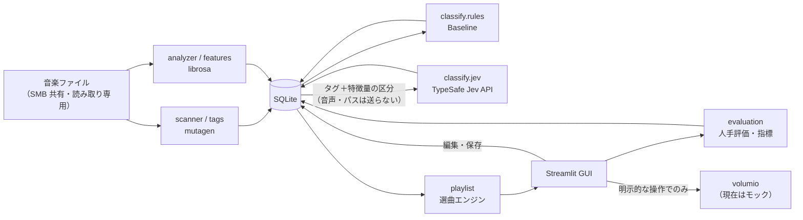

# アーキテクチャ

## 方針

- 個人利用のアプリとして、1 つの Python パッケージと 1 つの SQLite ファイルで完結させる。サーバーやマイクロサービスは使わない
- 音楽ファイルは読み取り専用。解析結果・評価・プレイリストはアプリ自身のデータとして SQLite に保存する
- 解析（特徴量抽出）・分類・選曲・GUI・保存を分ける。選曲は保存済みの分類結果だけを使い、外部 API を呼ばない
- 外部サービス（Jev、Volumio）がなくても、ルールベースの分類とモックで全体を動かせる
- 解析・分類の結果には、その結果を作ったロジックのバージョンを記録する

## 構成

```text
src/volumio_playlist_studio/
├── config.py          設定値・バージョン定数・既定値（共有する定数はここに集約）
├── models.py          モジュール間で受け渡すデータ型（楽曲、特徴量、分類結果、ジャンル・ムードの候補）
├── library_paths.py   パスの変換（WSL/Windows/UNC の入力、ログ用の相対パス、絶対パスの除去）
├── tags.py            mutagen によるタグ取得、文字化け修復、ファイル名からの曲名補完、重複検出用ハッシュ
├── scanner.py         フォルダの再帰スキャンと差分の反映
├── features.py        librosa による音響特徴量の抽出（区間サンプリング）
├── analyzer.py        未解析の楽曲の解析と、ルールベース分類の実行
├── classify/
│   ├── base.py        分類エンジンのインターフェース（Classifier）とムードの決定
│   ├── genre_tags.py  タグのジャンル表記の正規化
│   ├── rules.py       ルールベース分類（Baseline）
│   ├── descriptors.py 特徴量を Jev に渡す言葉の区分に変換
│   ├── jev.py         Jev による分類
│   └── runner.py      分類の一括実行（エラー時の継続・打ち切り、件数上限）
├── playlist.py        選曲エンジン（適合度、制約、曲順、条件不足の説明、編集操作）
├── evaluation.py      精度評価の指標、評価データの分割、CSV 出力
├── volumio.py         Volumio クライアントのインターフェース、モック、URI 照合、登録処理
├── catalog.py         画面・選曲エンジン向けのデータ集約（候補、ダッシュボードの集計）
├── workflows.py       画面から呼ぶ一連の処理（スキャン、解析、Jev 判定、見積もり）
├── jobs.py            バックグラウンドスレッドでの実行と進捗
├── launcher.py        起動処理（.env の読み込み、二重起動の検知、Streamlit の起動、ブラウザを開く）
├── lan_access.py      LAN モードの PIN 認証、PC の LAN の IP アドレス取得、QR コード生成
├── sample_data.py     架空のサンプルデータと合成音声の生成
├── storage/           SQLite の接続・マイグレーションと各テーブルの読み書き
└── gui/               Streamlit の画面（app.py がエントリポイント、views/ が各画面、lan.py が PIN 入力画面）

setup.cmd / start.cmd  Windows でダブルクリックする入口（中身は scripts/windows/*.ps1）
tools/                 開発用のツール（インデントが戻る箇所への空行の挿入）
```

## 起動と LAN 接続

- Windows では `start.cmd` → `scripts/windows/start.ps1` → `python -m volumio_playlist_studio.launcher` の順に呼び出す。WSL・Linux では launcher を直接実行する
- launcher はプロジェクト直下の `.env` を読み、同じポートで既に Streamlit が応答していれば 2 つ目を起動せずブラウザで開くだけにする。起動する場合は Streamlit を子プロセスとして実行し、応答を確認してからブラウザを開く
- 既定では `127.0.0.1` だけで待ち受ける。`.env` の `VPS_LAN=1` のときだけ全てのネットワークで待ち受け、localhost と判定できない接続（`st.context.ip_address` が `None` でない）には、ページを表示する前に PIN の入力を求める
- PIN と認証済みの印は `st.cache_resource` で全セッションに共有する `LanAccess` が持ち、プロセスのメモリにだけ置く。認証済みの印は Streamlit のセッション（ブラウザのタブ）に保存する

## データフロー



1. **スキャン**: フォルダを再帰的に探し、ファイルサイズと更新日時が変わったファイルだけタグを読み直す。見つからなくなった曲は削除せず `missing` にする（評価データを残すため）。読めないフォルダがあった場合は記録し、一時的な障害で曲が消えたと誤判定しないよう、そのスキャンでは `missing` の判定を行わない
2. **解析**: 未解析、ファイル更新後、または `ANALYSIS_VERSION` が古い曲を解析する。続けてルールベース分類を実行する
3. **Jev 判定**（任意）: 現在の `JEV_QUESTION_VERSION` の結果がない曲を、1 回の上限まで判定する
4. **選曲**: 設定した分類結果（ルール／Jev／Jev 優先）と人手で修正したジャンルを使い、プレイリストを生成する
5. **評価**: 人手の正解と各エンジンの結果を比較する
6. **Volumio 登録**: 保存したプレイリストを、URI を照合したうえで明示的な操作でのみ登録する

時間のかかる処理（スキャン、解析、Jev 判定）は `jobs.BackgroundJob` でバックグラウンドスレッドとして実行し、GUI は 1 秒ごとに進捗を更新する。バックグラウンド処理は専用の DB 接続を使い、SQLite は WAL モードで同時の読み書きに対応する。

## データモデル

スキーマは `storage/database.py` の `MIGRATIONS` で定義し、`PRAGMA user_version` でバージョンを管理する。変更は既存の要素を書き換えず、末尾に追加する。移行前に既存の DB をバックアップし、1 つのトランザクションで適用する。

| テーブル | 内容 | 主な列 |
|---|---|---|
| `tracks` | 楽曲メタデータ | `library_root`・`rel_path`（一意）、タグ、再生時間、ビットレート、`file_size`・`mtime_ns`（差分判定）、`quick_hash`（重複検出）、`status`（active/missing）、`tag_error` |
| `scans` | スキャン履歴 | 追加・更新・変更なし・消失・エラーの件数、所要時間 |
| `audio_features` | 音響特徴量 | `analysis_version`、解析パラメータ、特徴量（JSON）、解析時点のファイルサイズ・更新日時、所要時間 |
| `analysis_errors` | 解析エラー | 段階（tags/features/classification）、種類、メッセージ（絶対パスを除去済み）、バージョン、解決済みフラグ |
| `classifications` | 分類結果 | `engine`・`engine_version`（楽曲ごとに一意）、応答したモデル名、結果（JSON。確信度・確率を含む） |
| `evaluations` | 人手評価 | 用途（tuning/holdout）、評価時に表示した分類結果の ID、ジャンル・ムードの正誤と正解、属性の 5 段階評価 |
| `playlists` / `playlist_tracks` | 保存したプレイリスト | 生成条件（JSON）、seed、使った分類結果の種類、満足度／曲順、適合度、手動追加、不適切フラグ |
| `volumio_registrations` / `volumio_registration_items` | Volumio 登録履歴 | クライアントの種類、結果（success/partial/failed）、曲ごとの URI と結果 |
| `app_settings` | GUI で変更する設定 | 音楽フォルダ、解析パラメータ、Jev 設定、分類結果の種類（秘密情報は保存しない） |

## 分類エンジンの拡張（Essentia など）

分類エンジンは `classify.base.Classifier` を実装する。プレイリスト生成と精度評価は `ClassificationResult` だけを扱い、エンジンの種類に依存しない。Essentia を追加する場合は次のようにする。

1. 特徴量の抽出を `features.py` とは別のモジュールにし、結果を新しいテーブル（または `audio_features` に抽出器の列を追加）に保存する
2. `Classifier` を実装した `classify/essentia.py` を追加し、エンジン名とバージョンを付けて `classifications` に保存する
3. Essentia の特徴量を Jev に渡す場合（Essentia＋Jev）は、`descriptors.py` に区分を追加し、エンジン名を分ける
4. 精度評価画面の比較対象にエンジンを追加する

比較する観点は、精度（同じ検証用データでの一致率・誤差）に加え、1 曲あたりの解析時間、CPU 負荷、メモリ使用量、導入の難しさ（依存ライブラリ、WSL2 でのビルド）、モデルのライセンス。Essentia の導入は、現在の方式で明確な精度上の問題が確認されてから検討する（[evaluation.md](evaluation.md)）。

## 実装タスク

### 完了

- [x] Step 1: リポジトリ調査、基本設計（本書）、README、CLAUDE.md
- [x] Step 2: Streamlit の GUI（5 画面）、サンプルデータでの一連の操作
- [x] Step 3: mutagen・librosa による解析、SQLite 連携、差分スキャン、エラー記録、処理時間の記録
- [x] Step 4: Jev 連携の実装（HTTP 層をモックしたテストのみ）、精度評価画面
- [x] Step 5（一部）: Volumio クライアントのインターフェース、モック、URI 照合、登録処理と履歴

### 未完了

- [ ] Jev を実 API で少数の曲（5〜10 曲）に実行し、応答と判定結果を確認する
- [ ] Volumio 実機クライアントの方式を決めて実装する（[volumio.md](volumio.md) の確認事項）
- [ ] 実機で URI の対応、プレイリスト作成、曲の追加、再生を確認する
- [ ] 30〜50 曲で人手評価を行い、ルールベースと Jev を比較する（Step 6）
- [ ] 評価結果（調整用データのみ）に基づき、ルールの正規化範囲や Jev の閾値を調整する
- [ ] M4A/AAC の音響解析への対応（ffmpeg などのデコーダーが必要。導入前に確認）
